## Hi, I'm Carlos Romanow 👋

**Software & AI engineer** from Brazil. I build AI products end to end, from the first commit to deploy, across agents, games and developer tools.

- 🤖 Building desktop tools that put AI coding agents to work: Claude Code, Codex and Copilot
- 🎮 Making real-time multiplayer games for the browser
- 🎬 Exploring AI-driven video editing with Remotion
- 🎓 I.T. student at UFMS (Federal University of Mato Grosso do Sul)

### What I'm building

| Project | What it is | Stack | Status |
|---|---|---|---|
| [Taverna Harness](https://github.com/CaduhRoman/taverna-harness) | Claude Code, Codex and Copilot at one table, each task in its own git worktree | C# · Avalonia · AI agents | In progress |
| [Card War](https://guerra-de-cartas.vercel.app) | Real-time card battles in the browser, 1v1 or 2v2 online | Three.js · Next.js · Supabase | Beta |
| FramePilot | Video editing through chat: Claude writes the cuts in Remotion | Electron · Remotion · Claude Code | MVP |
| [romanow.pages.dev](https://romanow.pages.dev) | My portfolio, with Romi, an AI assistant behind Cloudflare Turnstile | React · TypeScript · Vite · Cloudflare Pages | Live |

### Tech stack

  
  &nbsp;
  
  &nbsp;
  
  &nbsp;
  
  &nbsp;
  
  &nbsp;
  
  &nbsp;
  
  &nbsp;
  
  &nbsp;
  
  &nbsp;
  

**AI:** Claude Code · Codex · Copilot · LLM APIs (Groq) · agents & tool use

### Take a break 👾

  

Click to play Space Invaders in your browser. Arrow keys to move, Space to shoot. Works on mobile too.

### Let's build something

